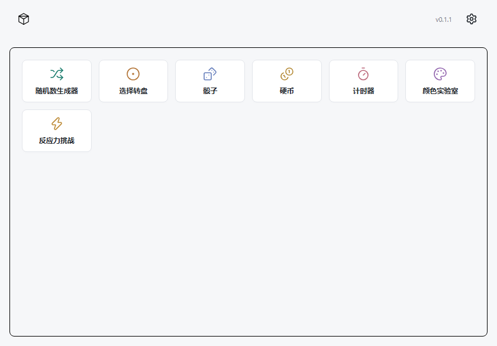

# 原匣

一个简洁的 Windows 离线工具箱，包含实用工具和小游戏。

## 下载与安装

在此仓库的 **Releases** 中下载最新版的 `yuanxia_版本号_x64-setup.exe`，双击安装后从桌面打开“原匣”。只需安装包，无需下载仓库 ZIP、Node.js 或 Rust。

下载入口：[GitHub Releases](https://github.com/zhyper611/yuanxia/releases) · [Gitee 发行版](https://gitee.com/zhang-huiyuan611/yuanxia/releases)。

- 支持 Windows 10/11 的 x64 系统。
- 首次安装需要 Microsoft Edge WebView2 Runtime；缺少时安装器会联网下载，之后各工具可离线使用。
- 当前安装包未做 Windows 代码签名，系统发布者会显示为未知；发布页提供 `SHA256SUMS.txt` 供核对文件。

## 功能

| 功能 | 内容 |
| --- | --- |
| 随机数生成器 | 0–100 范围内生成整数、批量、不重复和排序 |
| 选择转盘 | 自定义选项、整数权重、保存转盘 |
| 骰子 | D4 至 D100，每次 1–20 枚投掷与动画 |
| 硬币 | 每次 1–20 枚投掷、正反面统计与动画 |
| 计时器 | 秒/分钟倒计时、秒表及分段 |
| 颜色实验室 | 手动调色、屏幕取色、图片提色与配色收藏 |
| 反应力挑战 | 五轮测试、逐轮成绩与个人最佳 |
| 篮球挑战 | 拉拽投篮、经过物理验证的多样关卡、渐进难度、反弹加分 |

支持浅色、深色、跟随系统、主题色和背景图片。各工具配置会自动保留，历史可展开详情、复制和删除。

更多实用工具与趣味小游戏会陆续加入。客户端发现新版本时会提示，点击即可下载安装。

## 数据与更新

工具数据保存在当前 Windows 用户的应用数据目录，数据库名为 `yuanxia.sqlite`，不包含在安装包中。更换电脑前可在“设置 → 数据与关于”导出 JSON 备份，在新电脑中导入；背景图片需要重新选择。

倒计时按实际经过时间恢复，秒表也会继续计算退出期间的时间。反应力挑战重新开始。篮球挑战保留当前关卡、布局、得分与生命；飞行中离开或退出会消耗一次投篮机会，再次打开不会重复扣除。篮球战绩保存在历史记录中。

从 v0.1.1 开始，打开应用会后台检查更新，发现新版后提示；点击“下载并更新”即可下载安装并重新打开。配置和历史会保留，计时按实际经过时间继续。可在“设置 → 数据与关于”关闭“启动时检查更新”，或手动检查。没有新版或网络不可用时，启动检查不会弹窗。

更新包通过签名校验后才会安装。更新失败可重试，也可以从 Releases 下载新版安装包覆盖安装。旧版 v0.1.0 需手动安装一次 v0.1.1 或更新版本，才能获得应用内更新功能。

从 v0.1.2 开始，优先从 GitHub 检查和下载更新；检查失败或下载安装包失败时自动尝试 Gitee。下载切换时要求两边版本和签名一致。v0.1.1 用户升级一次即可获得镜像更新能力。

## 反馈

在此仓库的 Issues 中描述问题，附上应用版本、Windows 版本和复现步骤。截图请先遮住个人信息。

此仓库用于发布安装包和收集反馈，暂不公开应用源码。第三方许可随安装包附带，并在每个 Release 单独提供。
